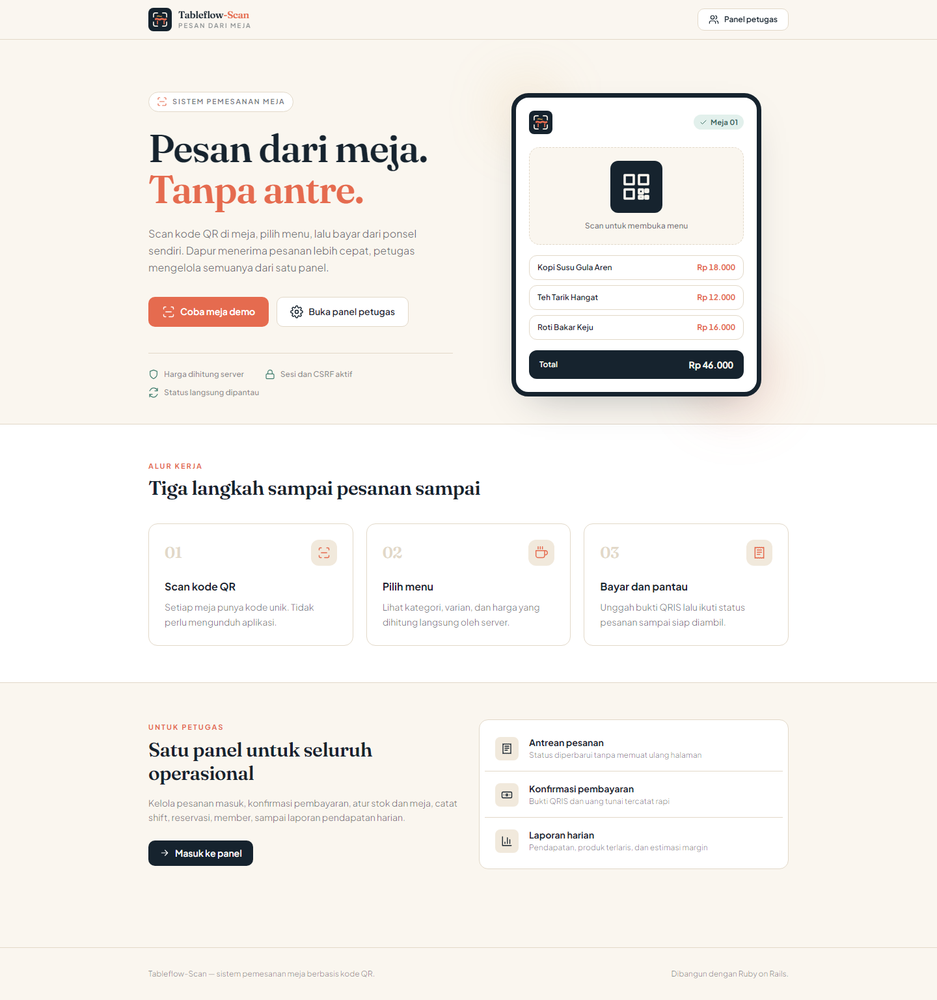
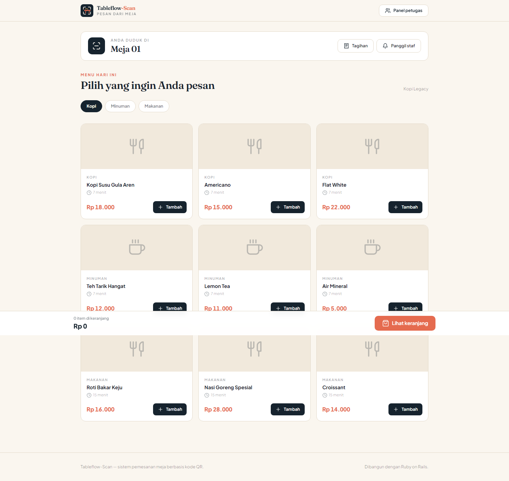
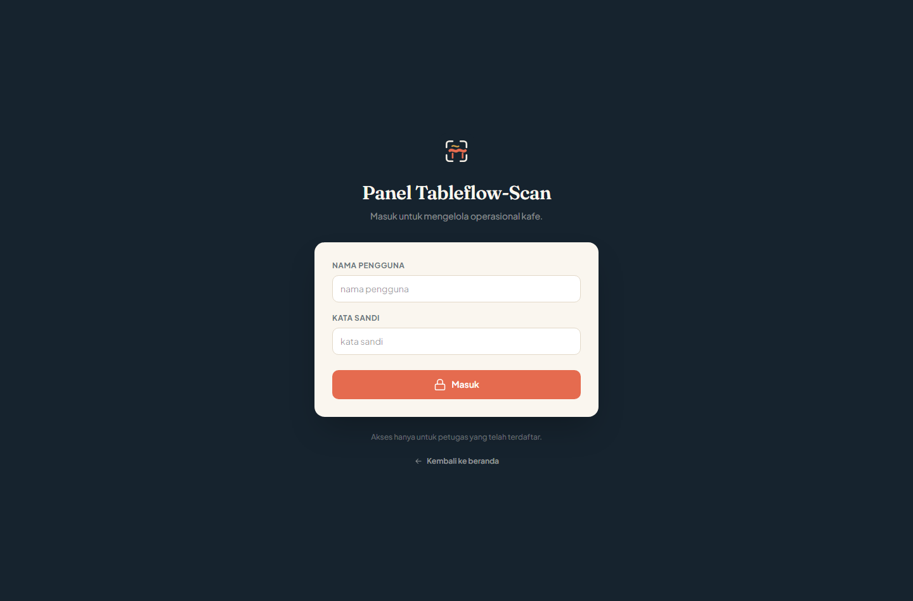
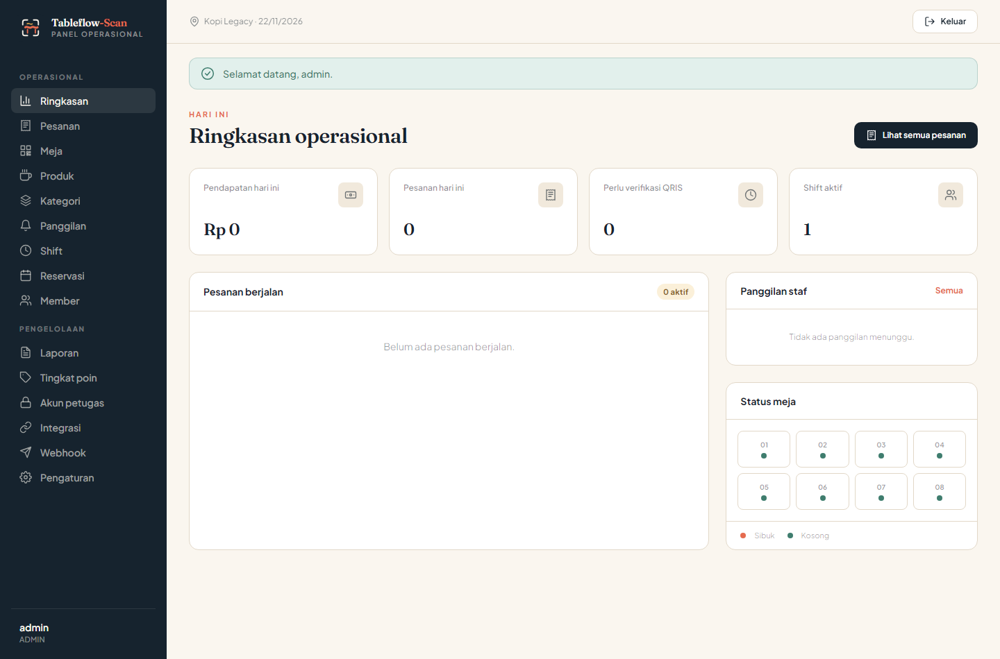
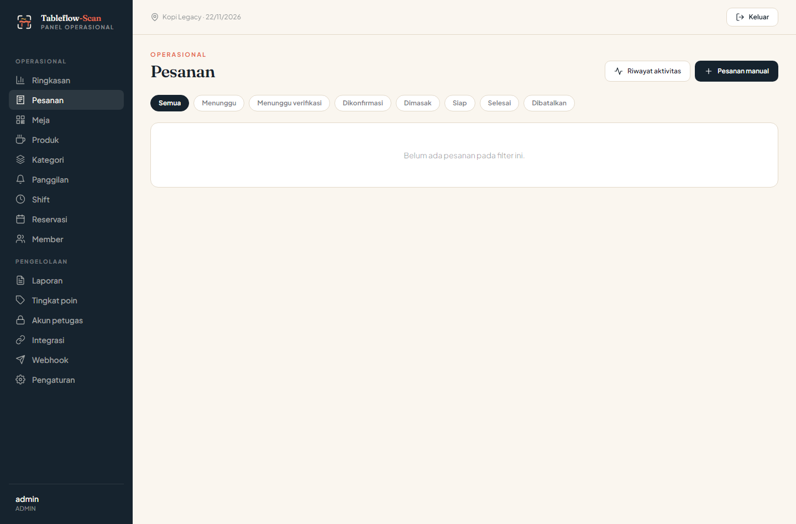
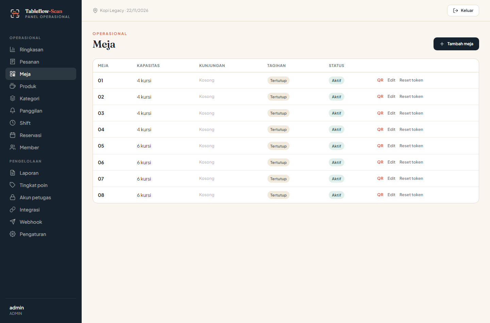
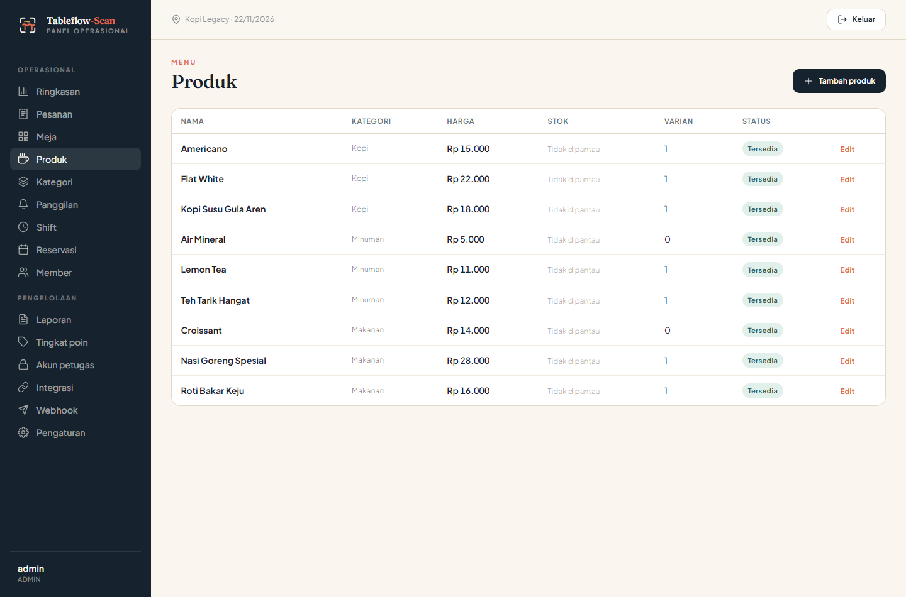
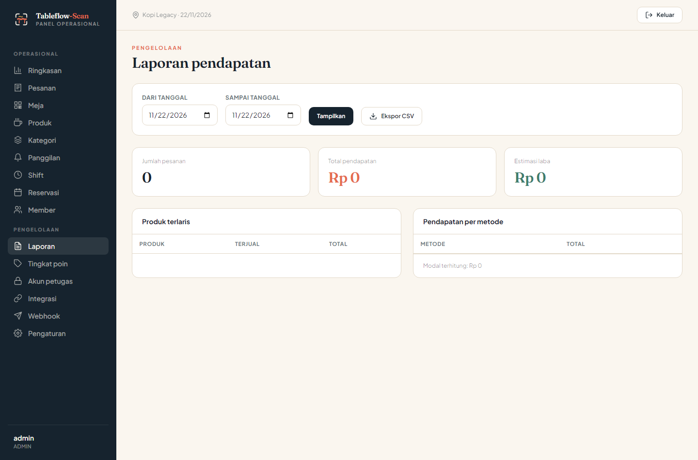
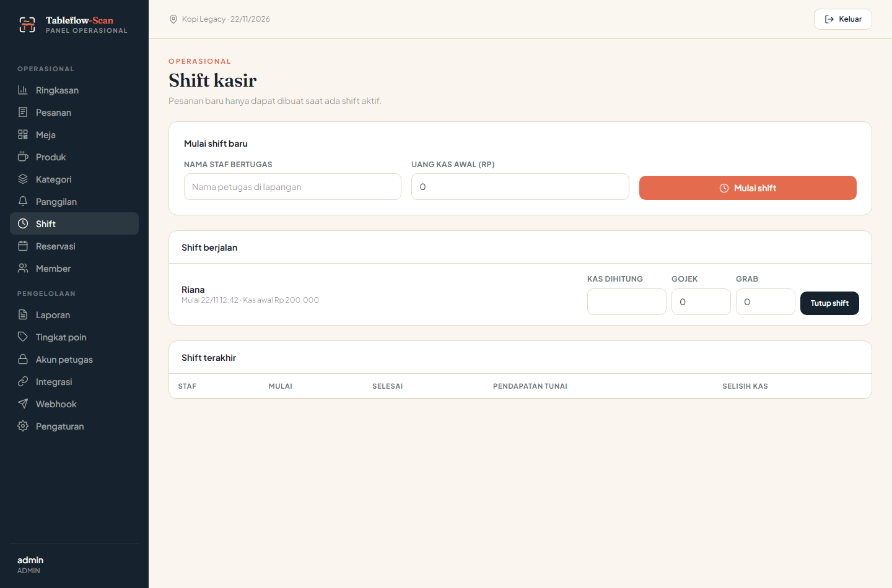
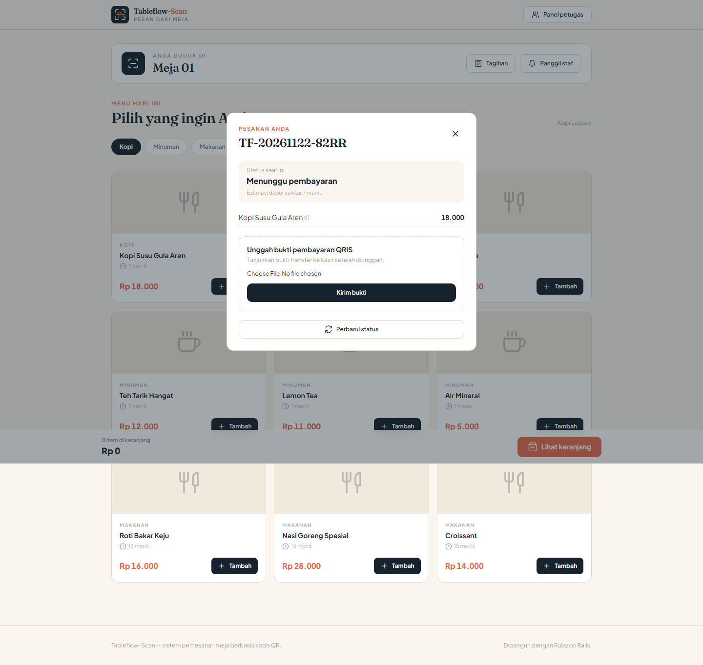

# Tableflow-Scan

Sistem informasi kafe berbasis kode QR untuk pemesanan di meja. Pelanggan memindai QR, memilih menu, membayar, dan memantau status pesanan. Petugas mengelola seluruh operasional melalui satu panel.

Proyek ini dibangun ulang dari awal dengan mempertahankan logika bisnis sistem sejenis, tetapi memakai tumpukan teknologi yang berbeda, identitas visual baru, serta penguatan keamanan. Tidak ada aset, teks, atau kode dari proyek lain yang disalin.

## Tampilan

Beranda:



Halaman pemesanan pelanggan setelah memindai QR meja:



Halaman masuk petugas:



Ringkasan operasional:



Daftar pesanan dan status:



Pengelolaan meja dan kode QR:



Pengelolaan produk:



Laporan pendapatan:



Pengelolaan shift dan rekonsiliasi kas:



Panel status pesanan sisi pelanggan:



## Fitur

### Sisi pelanggan

- QR unik per meja dengan token HMAC-SHA256.
- Menu per kategori dengan varian wajib, opsional, dan pilihan ganda.
- Keranjang tersimpan di peramban memakai kunci berdasarkan token meja.
- Total dihitung ulang sepenuhnya di server; harga tidak pernah dikirim klien.
- Pembayaran QRIS dengan unggah bukti, tunai, dan debit.
- Pemantauan status pesanan setiap 15 detik.
- Panggilan staf dan tagihan meja.
- Kunci idempotensi agar pengiriman ulang tidak membuat pesanan ganda.
- Diskon member berdasarkan poin loyalitas.

### Sisi petugas

- Panel operasional dengan ringkasan pendapatan, pesanan, antrean QRIS, shift, dan status meja.
- Konfirmasi pembayaran, verifikasi QRIS, dan perpindahan status pesanan.
- Pembatalan pesanan lunas dengan konfirmasi PIN petugas; stok dan poin dikembalikan.
- Pesanan manual/takeaway dengan perhitungan harga di server.
- Pengelolaan meja, kategori, produk, varian, dan stok.
- QR meja dirender sebagai SVG dan dapat direset.
- Panggilan staf, reservasi, member, tingkat loyalitas, dan shift.
- Laporan pendapatan, metode pembayaran, produk terlaris, dan estimasi margin.
- Pengaturan toko, pajak, biaya layanan, dan gambar QRIS.
- Manajemen kunci API dan webhook.
- Pembagian peran `admin` dan `kasir`.

### API

- API publik untuk menu, pengaturan, perhitungan total, pemesanan, status, pembayaran, panggilan staf, dan tagihan meja.
- API eksternal baca-saja dengan autentikasi header `X-TABLEFLOW-KEY`.
- Webhook dengan payload bertanda tangan HMAC-SHA256 pada header `X-Tableflow-Signature`.

## Tumpukan teknologi

| Bagian | Pilihan |
| --- | --- |
| Kerangka kerja | Ruby on Rails 8.1 |
| Bahasa | Ruby 3.3 |
| Database | SQLite |
| Frontend | Hotwire, Importmap, Stimulus, Tailwind CSS 4 |
| Otentikasi | Sesi cookie, bcrypt |
| Pembatasan laju | Rack::Attack |
| QR | RQRCode |
| Internasionalisasi | rails-i18n, bahasa Indonesia sebagai bawaan |

## Persyaratan

- Ruby 3.3 atau lebih baru.
- Bundler.
- SQLite 3.
- Tidak perlu server database terpisah.

## Instalasi

```bash
bundle install
bin/rails db:create db:migrate db:seed
bin/rails tailwindcss:build
bin/rails server
```

Aplikasi tersedia di `http://127.0.0.1:3000`.

Akun bawaan lingkungan pengembangan:

| Peran | Nama pengguna | Kata sandi | PIN |
| --- | --- | --- | --- |
| Admin | `admin` | `Tableflow2026!` | `246810` |
| Kasir | `kasir` | `Tableflow2026!` | tidak ada |

Data bawaan mencakup delapan meja, tiga kategori, dan sembilan produk. Untuk mencoba alur pelanggan, ambil tautan `/t/<token>` dari halaman daftar meja di panel admin.

## Struktur direktori

```text
app/
  controllers/publik/     alur pelanggan dan API publik
  controllers/admin/      panel operasional
  controllers/eksternal/  API baca-saja berbasis kunci
  javascript/controllers/ logika keranjang dan form varian
  models/                 model domain berbahasa Indonesia
  views/                  tampilan publik dan panel
lib/tableflow/            layanan inti dan aturan bisnis
db/migrate/               skema database
docs/screenshots/         tangkapan layar aplikasi berjalan
```

Layanan inti:

| Berkas | Tugas |
| --- | --- |
| `lib/tableflow/token_meja.rb` | Membuat dan memverifikasi token QR meja |
| `lib/tableflow/kalkulator_total.rb` | Menghitung subtotal, diskon, pajak, layanan, total, dan poin |
| `lib/tableflow/pembuat_pesanan.rb` | Membuat pesanan secara atomik dengan pengurangan stok |
| `lib/tableflow/pengelola_pesanan.rb` | Konfirmasi, perubahan status, dan pembatalan |
| `lib/tableflow/status_pesanan.rb` | Daftar perpindahan status yang diizinkan |
| `lib/tableflow/unggahan.rb` | Validasi berkas unggahan berdasarkan tanda biner |
| `lib/tableflow/pengaman_url.rb` | Perlindungan SSRF untuk URL webhook |
| `lib/tableflow/pengirim_webhook.rb` | Pengiriman webhook bertanda tangan |
| `lib/tableflow/laporan.rb` | Agregasi laporan pendapatan |
| `lib/tableflow/kode_pesanan.rb` | Pembuatan kode pesanan tanpa karakter ambigu |

## Keamanan

- Harga dihitung di server; klien hanya mengirim id produk, jumlah, id varian, dan catatan.
- Token QR memakai HMAC-SHA256 dengan rahasia per meja dan perbandingan waktu konstan.
- Kunci idempotensi mencegah duplikasi pesanan.
- Otentikasi sesi cookie dengan `HttpOnly`, `SameSite=Lax`, dan `Secure` di produksi.
- Kata sandi dan PIN disimpan sebagai hash bcrypt.
- Perlindungan CSRF bawaan Rails; klien JSON mengirim `X-CSRF-Token`.
- Pembatasan laju untuk masuk, pembuatan pesanan, pengecekan status, panggilan staf, dan API eksternal.
- Unggahan divalidasi berdasarkan tanda tangan biner, bukan hanya nama berkas, dengan batas 2 MB.
- URL webhook divalidasi terhadap alamat lokal, privat, dan metadata.
- Payload webhook ditandatangani HMAC-SHA256.
- Header keamanan: CSP, `X-Frame-Options`, `X-Content-Type-Options`, `Referrer-Policy`, dan `Permissions-Policy`.
- Pembatalan pesanan lunas memerlukan PIN petugas.
- Perubahan status memakai pembaruan optimistis agar dua petugas tidak saling menimpa.

## Alur status pesanan

```text
baru -> menunggu -> menunggu_verifikasi -> dikonfirmasi -> dimasak -> siap -> selesai
             \-------------> dikonfirmasi (tunai/debit)
```

Pembatalan dapat dilakukan dari status sebelum `selesai`. Status `dibatalkan` adalah akhir.

## Endpoint API publik

| Metode | Endpoint | Fungsi |
| --- | --- | --- |
| GET | `/api/publik/menu` | Daftar kategori, produk, dan varian |
| GET | `/api/publik/pengaturan` | Nama toko, pajak, biaya layanan, QRIS |
| POST | `/api/publik/keranjang/total` | Hitung ulang total keranjang |
| POST | `/api/publik/pesanan` | Buat pesanan |
| GET | `/api/publik/pesanan/:kode` | Cek status pesanan |
| POST | `/api/publik/pesanan/:kode/bayar` | Unggah bukti QRIS |
| POST | `/api/publik/panggilan-staf` | Kirim panggilan staf |
| GET | `/api/publik/meja/:token/tagihan` | Tagihan meja |

API eksternal: `GET /api/eksternal/v1/pesanan` dan `GET /api/eksternal/v1/produk` dengan header `X-TABLEFLOW-KEY`.

## Pemeriksaan

```bash
bin/rails zeitwerk:check
bin/rails routes
bin/rails runner script/smoke_check.rb
bin/rails runner script/smoke_qris.rb
ruby script/cek_erb.rb
ruby script/cek_rute.rb
```

Skrip verifikasi browser ada di `script/screenshot.js`, `script/uji_Alur.js`, dan `script/cek_semua_halaman.js`. Skrip tersebut memakai Chrome yang terpasang secara lokal dan `playwright-core`.

## Lisensi

MIT. Lihat berkas `LICENSE`.

---

## English summary

Tableflow-Scan is a cafe table-ordering system built with Ruby on Rails 8.1, SQLite, Hotwire, Stimulus, and Tailwind CSS. Customers scan a per-table HMAC token, browse the menu, pay through QRIS/cash/debit, and track order status. Staff manage orders, tables, products, shifts, reservations, members, reports, API keys, and webhooks through a role-based panel. Prices are recalculated server-side, orders use idempotency keys, uploads are validated by binary signature, webhook URLs are protected against SSRF, and webhook payloads are HMAC-signed. Setup instructions and demo credentials are in the Indonesian section above. The interface text and code conventions are in Indonesian by design.
